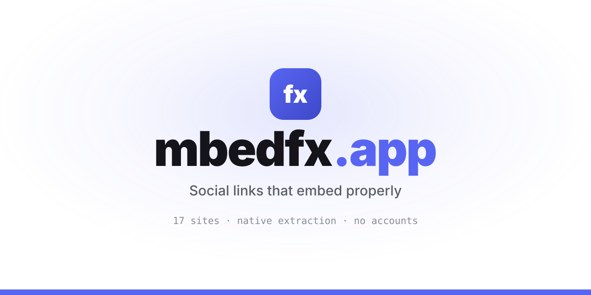

<div align="center">

<picture>
  <source media="(prefers-color-scheme: dark)" srcset=".github/social-preview.svg">
  
</picture>

<h1 align="center">mbedfx</h1>

[](LICENSE)
[](../../actions/workflows/ci.yml)
[](../../releases)
[](https://workers.cloudflare.com)

</div>

<p align="center"><strong>Social links that embed properly.</strong> Paste a link, get one Discord can actually draw. 17 sites, no accounts, nothing to install.</p>

<p align="center"><a href="https://deploy.workers.cloudflare.com/?url=https://github.com/shamu4life/mbedfx"></a></p>

<p align="center">Or run a copy of your own. Video needs Workers Paid, and nobody has tried the button or the Workers Free variant yet: <a href="#host-your-own">Host your own</a> says what that means.</p>

---

Discord builds a link preview from the page's `og:` tags. Most social sites don't serve them, or serve a login wall, and the preview comes out as a grey rectangle with a domain in it.

Swap the site's domain for **mbedfx.app** and the card appears: author, caption, counts, and a video that plays inline as a real MP4. Same post, same link.

---

## Get started

Take a link and swap the domain:

```
https://x.com/jack/status/20
https://mbedfx.app/jack/status/20
```

<https://mbedfx.app> does the same swap in the browser and draws the card before you send it. It also unfurls share codes.

> **<https://megapenispoopenfarten.sex>** runs the same worker. It's where this started, and links people already pasted still point at it.

### Forcing a site

Some paths belong to more than one site, and the domain that would have told them apart is gone. A two-letter code in front settles it:

```
https://mbedfx.app/im/gallery/YcAQlkx     Imgur
https://mbedfx.app/x/status/20            Twitter
```

`x` `tt` `ig` `th` `rd` `bs` `yt` `fb` `tw` `pn` `dm` `st` `im` `ms` `mk` `lm` `pt`, in the order of the table below.

Rarely needed: the converter page names the site it read a link as, offers a one-click fix, and gives a chooser for an ambiguous path. [docs/API.md](docs/API.md#ambiguous) has which sites claim which shape. If you do have to force one, [file a bug](../../issues/new/choose).

### Bluesky profiles

A Bluesky profile link works the same way, with nothing else edited:

```
https://bsky.app/profile/bsky.app
https://mbedfx.app/profile/bsky.app
```

The card carries the display name, the bio, the avatar, the follower, following and post counts, and
the month the account was created. bsky.app itself gives a crawler only a title, which is the reason
this one is here.

No other site's profile links work, and that is measured rather than pending. Twitter, TikTok and
Instagram all already hand a crawler a complete profile card of their own, so there is nothing to
fix; and their profile urls are a bare handle, which names an account on more than one of them at
once. A bare handle therefore stays a chooser rather than a guess.

### Just the media

Put `d.` in front of the domain and you get the file itself, the video or the image, at its own URL, with byte-range support so it seeks and downloads properly.

```
https://d.megapenispoopenfarten.sex/jack/status/20
```

Or, the way fxtwitter does it, put `.mp4` on the end of the link's path, before any `?`. It does the same thing on any of the domains.

```
https://megapenispoopenfarten.sex/jack/status/20.mp4
```

That goes for links whose post id sits after the `?` too: `/watch.mp4?v=…`, `/photo/.mp4?fbid=…`. A `.mp4` typed onto the end of the query instead (`watch?v=….mp4`) isn't read: a YouTube link stays a card, and a Facebook one gets the which-site chooser.

The converter page has a **media only** checkbox next to the domain buttons. A `d.` url renders no card; [docs/API.md](docs/API.md#the-d-host) has the rest. It works on every domain the converter offers, the two guest domains included (see [Official domains](#official-domains)).

## Supported sites

| | Site | Hosts |
|---|---|---|
|  | Twitter | `x.com` · `twitter.com` |
|  | TikTok | `tiktok.com` |
|  | Instagram | `instagram.com` |
|  | Threads | `threads.com` |
|  | Reddit | `reddit.com` |
|  | Bluesky | `bsky.app` |
|  | YouTube | `youtube.com` · `youtu.be` |
|  | Facebook | `facebook.com` |
|  | Twitch | `twitch.tv` · `clips.twitch.tv` |
|  | Pinterest | `pinterest.com` · `pin.it` |
|  | Dailymotion | `dailymotion.com` · `dai.ly` |
|  | Streamable | `streamable.com` |
|  | Imgur | `imgur.com` · `i.imgur.com` |
|  | Mastodon | any instance |
|  | Misskey | any instance |
|  | Lemmy | any instance |
|  | PeerTube | any instance |

A bare `dai.ly`, `redd.it` or `pin.it` code names no site on its own, so the converter page rewrites those. The short links that do resolve as pasted are in [docs/API.md](docs/API.md#the-hosts-column).

## Features

The container remuxes the stream into one progressive faststart MP4 (or keeps the site's own single progressive file as served), cached in R2 and served with `accept-ranges: bytes` for Discord's player to seek on. A cold video usually draws the cover image first, and a card that is still waiting is never response-cached, so a **later paste** of the same link plays. The message that was already posted does not heal: Discord caches an embed permanently in the message it was pasted into, and per-URL for about 30 minutes on top. For the reader who pasted first, the first paste is the only paste — which is why the mux is given a Durable Object alarm and 15 minutes rather than `waitUntil`'s 30 seconds, why YouTube's crawler callback is allowed four seconds to catch a mux that finishes fast, and why `card_degraded / ok` is the number that measures both. A card that is *final* rather than incomplete — too long to mux, or a live broadcast with no finished file behind it — does cache, deliberately. [container/README.md](container/README.md) has the resolver and its ceilings.

Posts that can't be read get a card naming the reason: 🔒 private or friends-only, 🔞 age-restricted, or deleted and never existed. Where the platform gives no reason the card lists the likely ones and picks none. A path two sites both claim is not guessed either ([docs/API.md](docs/API.md#failures) has the codes; `src/render/chooser.ts` draws the human version).

<details>
<summary><strong>Translation</strong></summary>

Captions that aren't in English get translated, with the original kept below it:

```
Chinese cabbage is delicious, isn't it?

🌐 Translated from Japanese
白菜おいしいね
```

Non-Latin scripts (Japanese, Korean, Chinese, Russian, Arabic, Thai, Greek, Hebrew, Hindi) are spotted from the characters alone. Latin-script languages have to be asked about: guessing by eye captions English posts as Portuguese. The cache is keyed on the caption text, and a post going around a lot is translated once.

</details>

<details>
<summary><strong>Tracking junk gets dropped</strong></summary>

`igsh`, `_t`, `si`, `utm_*` and Meta's share tokens are stripped before anything is handed onward. Meta mints a fresh share code on every share, which makes a pasted link traceable back to whoever shared it; those get cut to the part that names the post.

</details>

## JSON API

`/_api/v1?url=<the post url>` serves the post data the cards are drawn from, as JSON. No key or signup, and CORS is open to any origin.

```sh
curl -s 'https://mbedfx.app/_api/v1?url=https%3A%2F%2Fx.com%2Fjack%2Fstatus%2F20' | jq
```

Branch on `ok` and `error.code`, never on the HTTP status. The contract is [docs/API.md](docs/API.md) in prose and [`/openapi.json`](https://mbedfx.app/openapi.json) ([source](public/openapi.json)) in OpenAPI 3.1, covering every response shape, every error code and the nullability of every field, which a generator or a schema viewer reads directly.

## Caveats

- Every platform here is read through an endpoint nobody documents, and those change without warning. When one breaks, the card says so rather than showing a wrong card.
- An age-gated Instagram post needs an account to read. Nothing clever at the edge gets around that.
- Videos over 25 minutes come out as thumbnails. Past that the download stops being worth a container slot, so the mux is never started.
- Translation is machine translation. It gets things wrong, and the original sits underneath it.
- There is no uptime guarantee. This is a Cloudflare Worker on a hobby budget. It will probably be fine.

## Privacy

- The page sets no cookies, needs no account, and carries no analytics.
- The counters carry a platform code, an outcome and the caller's class, never a url, post id, IP or verbatim user agent ([docs/METRICS.md](docs/METRICS.md)).
- On mbedfx.app, R2 holds remuxed video, container metadata, translations keyed by a hash of the text, and Reddit posts as the Arctic Shift archive returned them, plus the mux give-up marks and the scheduled check's last week. A 60-day lifecycle rule expires all of it, and every item can be fetched again from its platform. A copy you deploy yourself has no expiry until you add that rule ([docs/SELF-HOSTING.md](docs/SELF-HOSTING.md#after-the-first-deploy) has the command). Under the Node adapter the media directory never expires.
- Cards cache for about 15 minutes, so a just-deleted post can linger that long.
- The Worker fetches from its own egress, and a reader's IP and user agent never reach the platform.

## How it compares

Checked 2026-08-01 against each project's docs, source and live service. **?** marks a cell that couldn't be established either way. The rival columns are frozen at that date; the mbedfx column is kept current.

| | **mbedfx** | [FxEmbed](https://github.com/FxEmbed/FxEmbed) | [vxTwitter](https://github.com/dylanpdx/BetterTwitFix) | [fxTikTok](https://github.com/okdargy/fxTikTok) | [InstaFix](https://github.com/Wikidepia/InstaFix) | [InstaFix Revived](https://github.com/Bl0ck154/InstaFix-Revived) |
|---|---|---|---|---|---|---|
| Sites covered | **17** | 2 documented, 4 live | Twitter | TikTok | Instagram | Instagram |
| Working public instance | ✅ | ✅ + status page | ✅ | ✅ | ❌ archived, self-host only | ✅ |
| How video reaches Discord | own remux | platform MP4 | CDN redirect | CDN redirect | CDN redirect | streamed |
| Caption translation | ✅ automatic | opt-in `/en` | opt-in `/en`, undocumented | ❌ | ❌ | ❌ |
| Card says *why* a post is missing | ✅ private / age / deleted | ? | ? | age only | ❌ redirects | one generic card |
| Public JSON API | [✅ documented](docs/API.md) + [OpenAPI](public/openapi.json) | ✅ OpenAPI | ✅ documented | ❌ | ❌ | undocumented |
| Self-host off Cloudflare | [Node adapter, Docker compose](docs/SELF-HOSTING.md#host-it-with-docker-compose) | ❌ Workers | ✅ Docker · systemd · Lambda | Docker, undocumented | ✅ Docker · K8s | ✅ Docker |
| Operator metrics | [documented queries](docs/METRICS.md), no scrape endpoint | ? | ? | ✅ Prometheus | pprof | pprof |

FxEmbed goes deeper on Twitter than mbedfx goes on any single site. The remux is a workaround: most of the seventeen won't hand a bot a playable file, and it buys nothing on Twitter or TikTok, which already serve one.

## Official domains

The public instance answers on these three hosts:

`mbedfx.app` · `megapenispoopenfarten.sex` · `forsen.sex`

`d.` works on all three.

Two more domains serve the same cards as guests: `sorryifuckedyour.mom` and `hotsinglesnear.you`. Their front pages belong to another site, so only post links and Bluesky profile links work there: swap the host and the post unfurls as usual. The converter offers both as domain buttons, next to `mbedfx.app` and `megapenispoopenfarten.sex` (`forsen.sex` works but isn't offered). The converter page itself and the JSON API stay on the three hosts above. `d.` works on all five (`d.hotsinglesnear.you/jack/status/20` is the file), and so does a trailing `.mp4`. A link on a guest domain that names neither a post nor a Bluesky profile, a bare `/{handle}` for instance, opens the other site's page rather than the which-site chooser, and the converter's preview says so. A wildcard DNS record covers exactly one label; a deeper name such as `d.staging.mbedfx.app` would need a record of its own.

Other domains can run copies of this code ([Host your own](#host-your-own)), and their cards say `mbedfx` unless the operator sets `SITE_NAME`. This project doesn't run them or vouch for them, and a problem with one goes to whoever runs it.

## Host your own

> [!WARNING]
> Nobody has deployed mbedfx with the Deploy to Cloudflare button or on the Workers Free plan yet. Both are written from Cloudflare's documentation and this repo's configs, not from a run. The Docker setup was built and run by hand on one Linux host on 2026-11-25, and CI doesn't build it.

| Way | You need | Video | Tested |
|---|---|---|---|
| Deploy to Cloudflare button | A GitHub account, and a Cloudflare account on Workers Paid (Containers need it) | Yes | No |
| Cloudflare, from a checkout | Workers Paid, Node 22.18 or later, and Docker running while you deploy | Yes | No |
| Docker Compose | Docker with Compose v2 on an x86_64 host, and a reverse proxy that terminates TLS | Yes | By hand, once |
| Node, without Docker | Node 22.18 or later, plus the resolver for video (its image, or Python with ffmpeg, yt-dlp and Deno) | Only with the resolver | The adapter ran once |

Either Cloudflare way also runs on Workers Free through `wrangler.free.jsonc`, without the container, and there a video that needs muxing shows its cover image. [docs/SELF-HOSTING.md](docs/SELF-HOSTING.md) is the full guide: every step, what each way costs, and what each one has been measured doing.

### On Cloudflare

[](https://deploy.workers.cloudflare.com/?url=https://github.com/shamu4life/mbedfx)

The button copies this repository into your GitHub account, connects the copy to Workers Builds, and creates what the root `wrangler.jsonc` asks for: an R2 bucket, three Durable Objects, Workers AI, an Analytics Engine dataset and the video container. The Worker is `mbedfx-selfhost` on workers.dev, separate from mbedfx.app. On Workers Free, change the deploy command on the setup page to `npx wrangler deploy -c wrangler.free.jsonc` before the first build, and the branch command too ([the guide](docs/SELF-HOSTING.md#on-workers-free) has it).

From a checkout instead:

```bash
git clone https://github.com/shamu4life/mbedfx.git && cd mbedfx
npm ci
npx wrangler login
npm run deploy    # Workers Paid; builds the container image, so Docker must be running
```

Then give the bucket its 60-day expiry, once. Nothing else ever deletes from it:

```bash
npx wrangler r2 bucket lifecycle add mbedfx-selfhost-media expire-60d --expire-days 60
```

### With Docker

```bash
git clone https://github.com/shamu4life/mbedfx.git && cd mbedfx
umask 077
printf 'PUBLIC_ORIGIN=https://<YOUR_DOMAIN>\nRESOLVER_SECRET=%s\n' "$(openssl rand -hex 32)" > adapters/node/.env
docker compose -f adapters/node/compose.yaml up --build -d
curl -s 'http://127.0.0.1:8787/_api/v1?url=https%3A%2F%2Fbsky.app%2Fprofile%2Fbsky.app%2Fpost%2F3msqpuobiwk2t' | jq .ok
```

The last line prints `true` once the stack is up and the Bluesky post loads. Compose won't start without `PUBLIC_ORIGIN` and `RESOLVER_SECRET`. It publishes the adapter on `127.0.0.1:8787` only and the resolver not at all, so put your TLS proxy in front of port 8787 and have it pass the client's `Host` header through. [The guide](docs/SELF-HOSTING.md#host-it-with-docker-compose) covers logs, updates, where the media goes, and the measured run.

Your copy of the repo carries this project's GitHub workflows too. If Actions run there, one of them opens a yt-dlp bump pull request every Monday that yt-dlp has shipped a release, and the health check stays off until you set the `HEALTH_BASE` repository variable ([details](docs/SELF-HOSTING.md#with-the-deploy-to-cloudflare-button)).

## Configuration

Nothing below is required on Cloudflare. Under Docker Compose, `PUBLIC_ORIGIN` and `RESOLVER_SECRET` are.

On Cloudflare, set a plain setting as a variable in the dashboard (Workers & Pages, your Worker, Settings, Variables and Secrets); `keep_vars` in `wrangler.jsonc` keeps dashboard variables across deploys. Set a credential with `npx wrangler secret put <NAME>`, which reaches the Worker named in your `wrangler.jsonc`. If your Worker has another name, for example one you picked on the Deploy to Cloudflare page, add `--name <your-worker>` or use the dashboard. For mbedfx.app itself, add `-c wrangler.production.jsonc`. On Docker or Node, both kinds go in `adapters/node/.env` or the environment.

| Name | Kind | Default | What it does |
|---|---|---|---|
| `PUBLIC_ORIGIN` | variable | unset; on Node `http://localhost:$PORT` | Your origins, space- or comma-separated, primary first. The scheduled check renders on the primary, the converter page offers each as a domain button, and the fediverse guard refuses each. On Node it is also what card URLs are built on |
| `OWN_HOSTS` | variable | unset | More hostnames this deployment answers on, so a request on one can't make the Worker fetch another |
| `GUEST_HOSTS` | variable | unset (none) | Domains of another Worker that passes this one its post links over a service binding (`src/guesthost.ts`) |
| `SITE_NAME` | variable | `mbedfx` | The name in `og:site_name` and the oEmbed `provider_name` |
| `REDDIT_USER_AGENT` | variable | `web:<primary host>:v0.1` | Sent only to Reddit's OAuth API. Reddit asks for `web:<host>:<version> (by /u/<you>)` |
| `YT_PROMISE` | variable | off | `on` promises Discord an MP4 for a cold YouTube video of known length, up to 240 s. Anything else leaves it off |
| `TRANSLATE_GOOGLE` | variable | on | `off` stops the calls to Google's translate endpoint |
| `IG_GRAPHQL_DOC_ID` | variable | built in | Pins Instagram's shortcode GraphQL query id, which Meta rotates |
| `MUX_BUFFER_MAX` | variable | 64 MiB | The most one muxed MP4 may buffer in memory, for a media store with no `putStream`. Neither shipped runtime buffers one |
| `RESOLVER_SECRET` | secret | unset | The shared secret between the adapter and the resolver. Compose requires it. On Cloudflare it has no effect today (below) |
| `IMGUR_CLIENT_ID` | secret | yt-dlp's public id | Your own Imgur API client id |
| `REDDIT_CLIENT_ID`, `REDDIT_CLIENT_SECRET` | secret | unset | Reddit's OAuth fallback. It needs both |
| `REDDIT_RELAY_URL`, `REDDIT_RELAY_KEY` | secret | unset | Sends Reddit and archive reads through `relay/` ([relay/README.md](relay/README.md)) |
| `YT_ACCOUNTS`, `IG_ACCOUNTS`, `X_ACCOUNTS` (and `_2`, `_3`) | secret | unset | Account pools for age-gated posts ([docs/CREDENTIALS.md](docs/CREDENTIALS.md)) |

`IMGUR_CLIENT_ID` falls back to the id yt-dlp publishes. That id works, and its bucket is shared with every other tool using it; a free one of your own avoids the competition.

`IG_GRAPHQL_DOC_ID` pins Instagram's shortcode GraphQL query, which Meta rotates. When the pinned id dies, the older recoveries carry the card and the `copyright_gql` counter drops to zero. Re-pinning it is a config change and needs no release.

`REDDIT_CLIENT_ID` / `REDDIT_CLIENT_SECRET` turn on Reddit's OAuth fallback. Both must be set for it to run at all (`fetchReddit` in `src/platforms/reddit/fetch.ts`), and it runs only after the credential-free embed read comes back empty. Set `REDDIT_USER_AGENT` with them: the default names no Reddit account.

`TRANSLATE_GOOGLE=off` stops the calls to Google's translate endpoint, and Workers AI then translates on its own. The Node adapter has no Workers AI, so there it turns translation off.

The three `*_ACCOUNTS` pools each buy something different. `YT_ACCOUNTS` turns an age-gated video into an ordinary card. `IG_ACCOUNTS` is spent only inside the container's mux. Both of those pools need the container, so on `wrangler.free.jsonc` they do nothing. Instagram's gate verdict comes off the Worker's own page fetch, which carries no cookie jar, and the pool leaves that detection where it was. **Setting `X_ACCOUNTS` changes nothing today**: the call that would spend it is not built, and gated tweets keep getting the honest 🔞 card. [docs/CREDENTIALS.md](docs/CREDENTIALS.md) covers all three: the JSON each takes, how to export a `cookies.txt` without invalidating it, and the `pool_unused` counter that reports a configured pool going unspent.

`RESOLVER_SECRET` locks the resolver's `/resolve`. Under Docker Compose both services read it from `adapters/node/.env`. On Cloudflare the Worker sends it, but `src/container.ts` passes the container no environment, so the container never checks it there. That container is reachable only through its Durable Object.

[docs/SELF-HOSTING.md](docs/SELF-HOSTING.md#settings) has every setting, including the Node adapter's own and the resolver's, and [what degrades without each binding](docs/SELF-HOSTING.md#what-replaces-each-binding-and-what-degrades-without-it).

## How it works

<details>
<summary><strong>Discord reads two different documents</strong></summary>

Both heads need the same fix, or half the posts stay broken. For a post with media it follows the `<link rel="alternate" type="application/activity+json">` tag and renders a Mastodon-shaped status. For a post without media it reads the plain OpenGraph head.

</details>

- `src/router.ts` reads the path and the query, never the host, and returns a `Route`.
- `src/refkey.ts` is the security boundary for what crosses the wire and back.
- `src/render/` draws the two heads, the Mastodon spoof and the failure cards.
- `src/translate.ts` holds detection, translation and the marker.
- `public/index.html` is the converter page: one file, no framework.

[CONTRIBUTING.md](.github/CONTRIBUTING.md) has the commands, what CI runs, and the steps for adding a site. It also explains why mbedfx.app deploys only from Workers Builds, and what `npm run deploy` does instead: it makes a separate Worker in your own account. [docs/SELF-HOSTING.md](docs/SELF-HOSTING.md) walks `handle()` in `src/worker.ts`, the eight Cloudflare surfaces behind it and `container/server.py`.

## Contributing

Bugs and feature requests go through the [issue templates](../../issues/new/choose); what to run before a PR is in [CONTRIBUTING.md](.github/CONTRIBUTING.md). Everyone taking part follows the [Code of Conduct](.github/CODE_OF_CONDUCT.md).

If your PR rests on what an upstream returned, say where you ran it. A datacenter IP and a residential one are served different bytes, and more than one feature here worked from a laptop and did nothing in production.

## Changelog

Every release is in [CHANGELOG.md](CHANGELOG.md) (Keep a Changelog, Semantic Versioning), and tagged releases are on the [Releases](../../releases) page.

## Security

Do not open a public issue for a security problem. [SECURITY.md](.github/SECURITY.md) has the private route.

## Credits

Built by [**Claude**](https://claude.com/claude-code) (Anthropic), directed by [@shamu4life](https://github.com/shamu4life).

Prior art: [fxtwitter](https://github.com/FixTweet/FxTwitter), [vxtwitter](https://github.com/dylanpdx/BetterTwitFix), [InstaFix](https://github.com/Wikidepia/InstaFix) and the rest of the embed-fixer lineage. No code is shared with them apart from the Twitter GraphQL feature-flag table in [NOTICE.md](NOTICE.md). Icons from [Simple Icons](https://simpleicons.org). Video from [yt-dlp](https://github.com/yt-dlp/yt-dlp) and [FFmpeg](https://ffmpeg.org). Full notices in [NOTICE.md](NOTICE.md).

## Trademarks

All product and company names are trademarks of their respective owners. mbedfx is not affiliated with or endorsed by any of them.

## License

MIT. The full text is in [LICENSE](LICENSE).
